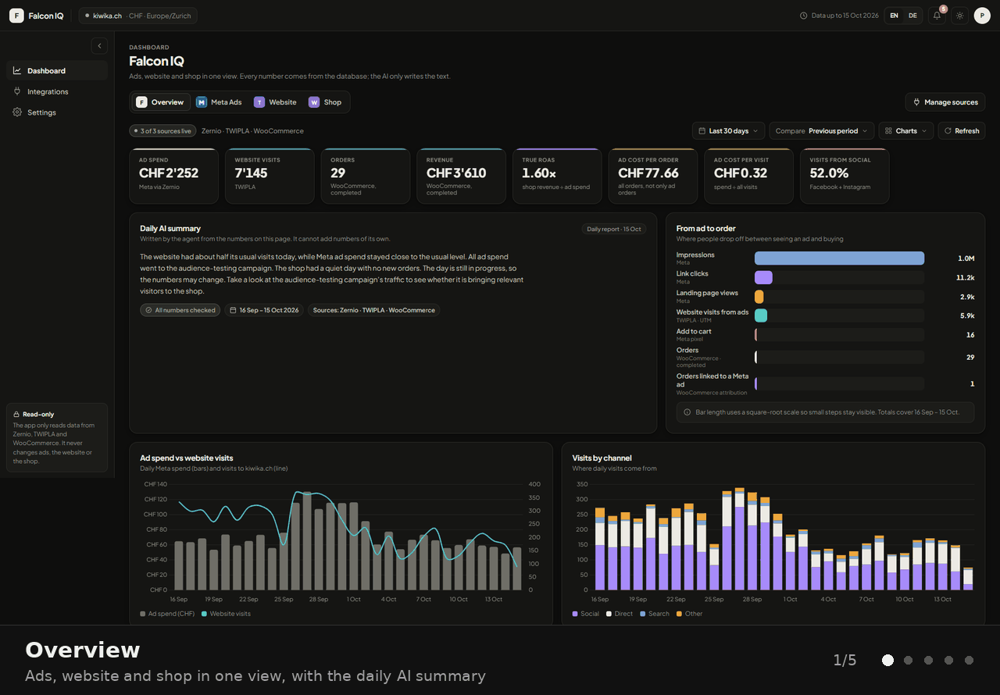
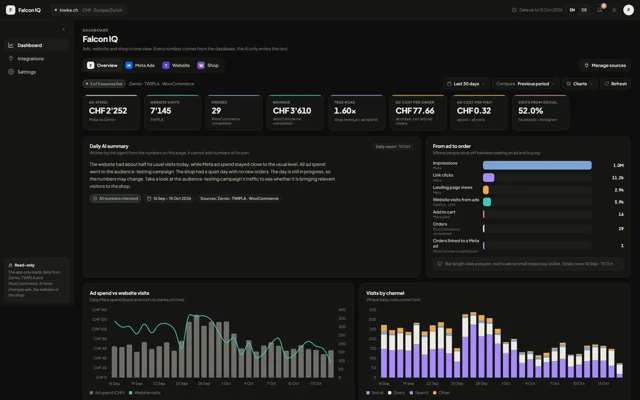
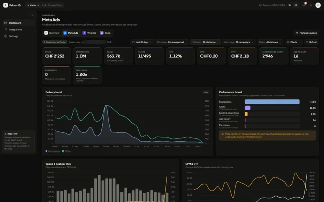
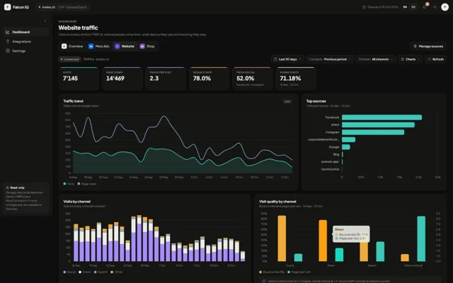
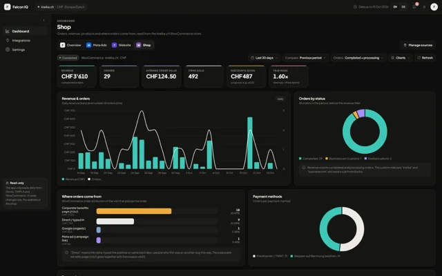
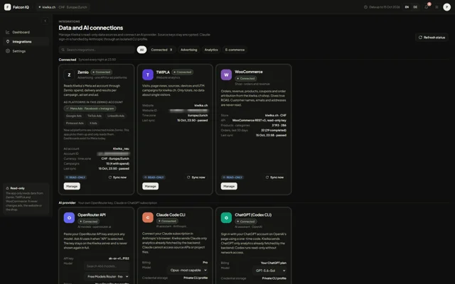
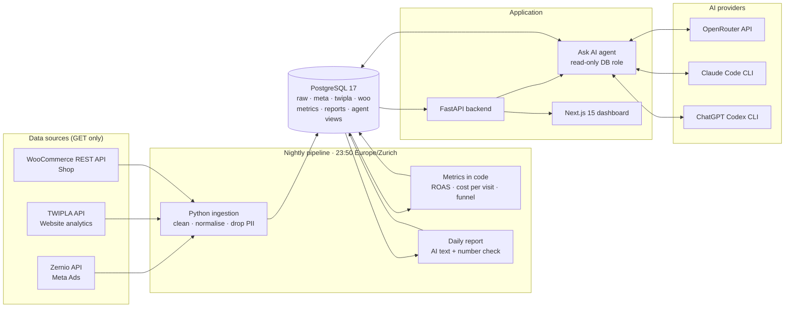

# Falcon IQ · E-commerce Analytics AI Dashboard

**One dashboard for ad spend, website traffic and shop revenue, with an AI analyst that answers only from the database.**

Built for a Swiss online pet-supplies store · Live in production on a private VPS · Phase 1 (read-only) complete

 

Auto-playing tour of the five main screens. Click a thumbnail below to open the full-resolution screenshot.

<table>
  <tr>
    <td align="center"><a href="docs/screenshots/01-overview.webp"> <b>Overview</b></a></td>
    <td align="center"><a href="docs/screenshots/02-meta-ads.webp"> <b>Meta Ads</b></a></td>
    <td align="center"><a href="docs/screenshots/03-website.webp"> <b>Website</b></a></td>
    <td align="center"><a href="docs/screenshots/04-shop.webp"> <b>Shop</b></a></td>
    <td align="center"><a href="docs/screenshots/05-integrations.webp"> <b>Integrations</b></a></td>
  </tr>
</table>

> **Note:** This is a client project, so the source code is private. This repository is a showcase of the product, its architecture and the engineering decisions behind it. Account and property IDs in the screenshots are blurred.

---

## The question it answers every day

> *How much did we spend on ads → how many people came to the website → what did they do there → how many orders and how much revenue followed?*

Before Falcon IQ, the answer lived in three different tools: Meta Ads Manager, a website-analytics product and the WooCommerce admin. Falcon IQ joins them in one database, computes the metrics in code, and shows the full funnel from **ad impression to paid order**, including the **true ROAS** (shop revenue ÷ ad spend) that none of the individual tools can show on its own.

## Highlights

- **Three live data sources** synced every night: Meta Ads via Zernio, TWIPLA website analytics, and the WooCommerce store.
- **Full ad-to-order funnel**: impressions → link clicks → landing page views → website visits from ads → add to cart → orders → orders linked to a Meta campaign.
- **Campaign attribution** by joining Meta campaign IDs with TWIPLA UTM labels and WooCommerce order-attribution data.
- **Ask AI** chat where OpenRouter models, Claude or ChatGPT answer questions by querying the analytics database.
- **Bring your own AI subscription**: connect a Claude Pro/Max or ChatGPT Plus/Pro account through the official CLIs, or paste an OpenRouter API key.
- **Daily AI summary** in English and German, written by the AI but with every number verified against the database.
- **Read-only by design**: the app never changes ads, the website or the shop.
- **Privacy first**: customer names, emails, addresses, IPs and user agents are dropped at ingestion and never stored.

## Screens

| Screen | What it shows |
| --- | --- |
| **Overview** | Eight headline KPIs (ad spend, visits, orders, revenue, true ROAS, ad cost per order, ad cost per visit, social share), the daily AI summary, the ad-to-order funnel, spend vs. visits, visits by channel, and a campaign funnel table. |
| **Meta Ads** | Spend, impressions, reach, clicks, CTR, CPC, CPM, landing page views, add to cart, purchases. Delivery trend, performance funnel, spend & CPC, CPM & CTR, reach & frequency, **platform breakdown** (Instagram, Facebook, Audience Network, Threads), spend by campaign and a drill-down campaign table. |
| **Website** | Visits, page views, pages per visit, bounce rate, social share, device share. Traffic trend, top sources, visits by channel, visit quality per channel, devices, browsers, operating systems, UTM campaigns matched to Meta spend, and referring sites. |
| **Shop** | Revenue, orders, average order value, items sold, discounts, true ROAS. Revenue & orders trend, orders by status, where orders come from, payment methods, top products, coupons and a weekly summary. |
| **Integrations** | Connection cards for every data source and AI provider with *Test connection*, *Save keys*, *Sync now* and *Disconnect*, plus model pickers for OpenRouter, Claude and ChatGPT. |

Every view has date ranges, period comparison, filters (platform, campaign, status, channel, order status), chart toggles, CSV export, an **EN | DE** language switch, light/dark theme and a notification center.

## Data sources

All source APIs are used **read-only (HTTP GET only)**. No endpoint that creates, updates or deletes anything is ever called.

### Meta Ads via Zernio
[Zernio](https://zernio.com) is a "one API for every ad channel" service. The Meta ad account is connected inside Zernio once, and Falcon IQ reads everything through Zernio's API.

- Daily insights per campaign: spend, impressions, reach, clicks, landing page views, add to cart, purchases.
- **`publisher_platform` breakdown** to split one Meta ad account into Instagram, Facebook, Messenger, Audience Network and Threads.
- Campaigns, ad sets and ads with status, budget and creatives as dimension tables.
- Daily account totals as a cross-check.
- Zernio can also connect Google, TikTok, LinkedIn, Pinterest and X Ads, so new channels can be added without a new integration.

### TWIPLA (website analytics)
- Visits and page views per day, visits per channel (social, direct, search, paid, email, other) and per source company.
- Bounce rate and pages per visit, per day and per channel.
- Devices, browsers and operating systems.
- **UTM campaigns**, whose labels are the Meta campaign IDs. This is the key that joins ad spend to real website visitors and gives a true *cost per visitor* per campaign.
- Range-only endpoints are called once per day to build daily rows.

### WooCommerce (shop)
- Orders by date and status, revenue, items, discounts, coupons, payment methods, products and categories.
- **Order attribution** (source type, UTM, referrer) to see which orders came from Meta ads, Google, direct visits or a partner page.
- Customer endpoints and all personal fields are never read or stored. Calls are sequential and paced to respect the shop's CDN.

## Architecture

**Pipeline.** A systemd timer starts the pipeline container every night at 23:50 Swiss time. It re-reads the **last three days** from every source, because Meta and TWIPLA keep updating recent numbers. All writes are idempotent upserts, so a run can be repeated safely. Missed runs are caught up automatically after a server restart.

**Database.** PostgreSQL 17 with separate schemas for raw responses, each source, computed metrics, reports and AI-facing views. Three database roles keep duties apart: an owner for migrations, an ingest role for the pipeline, and a **reader role** that is the only one the dashboard and the AI can use.

**Backend.** FastAPI serves the aggregated dashboard payload, health checks, notifications, integration actions (test, save, sync, disconnect) and the Ask AI endpoint.

**Frontend.** Next.js 15 + React 19, generated from a single design template so the look stays consistent. Authenticated sessions, EN/DE localisation with Swiss spelling, and smooth chart animations on refresh.

## Ask AI: an analyst that only trusts the database

The **Ask AI** button opens a chat where you can ask things like *"Which campaign had the cheapest cost per visitor last week?"* or *"How did revenue this month compare to last month?"*

1. The question goes to the selected AI provider together with a description of the read-only analytics views.
2. The model **writes SQL** to fetch exactly the data it needs. The backend runs it with the **read-only reader role**, so the AI can never change or delete anything.
3. Providers without tool calling receive a pre-fetched data pack instead (selected period, latest day, last 7/14/30 days, this/last week and month, daily rows).
4. The answer is written from those results only. A **number validator** checks every figure in the AI's text against the query results before it is shown.

The AI never calls Zernio, TWIPLA or WooCommerce directly. It only sees the database.

### Three ways to power the AI

| Provider | How it works | Billing |
| --- | --- | --- |
| **OpenRouter API** | Paste an OpenRouter key and pick any of 400+ models in Settings. | Pay-as-you-go OpenRouter credits |
| **Claude Code CLI** | Sign in with your own Claude account in Anthropic's browser flow. The official CLI runs on the server in an isolated profile. | Your existing **Claude Pro / Max** plan |
| **ChatGPT (Codex CLI)** | Sign in with your ChatGPT account using a one-time code. Codex runs in a read-only sandbox with no network access. | Your existing **ChatGPT Plus / Pro** plan |

The CLI options let a team use the AI subscription they already pay for instead of opening a separate API account. CLI credentials stay in a private, isolated profile on the server. They are never written to `.env` or to the database.

### Daily AI summary
Every night the pipeline writes a short summary of the day in **English and German**. It uses whichever AI is connected, in the order OpenRouter → ChatGPT → Claude, and falls back to a template text if none answers. Every number is checked against the computed metrics, and a guard rejects replies where a model "thinks out loud" instead of writing the summary.

## Security and privacy

- **Read-only sources.** Only GET requests to Zernio, TWIPLA and WooCommerce. Nothing in the ads, website or shop can be changed by the app.
- **No personal data.** Customer endpoints are never called, and names, emails, addresses, IPs and user agents are stripped before anything is stored.
- **Least-privilege database roles.** The dashboard and AI use a reader role that cannot write.
- **Verified AI output.** Numbers in AI text must match database results, or the text is rejected.
- **Isolated AI CLIs.** Claude and ChatGPT CLIs run in separate profiles with an environment allowlist; Codex runs sandboxed without network.
- **Secrets stay on the server.** API keys live only in the server's environment or in an encrypted settings store and are masked in the UI.
- **HTTPS everywhere** through Caddy, plus authenticated app login with hashed passwords and session versioning.

## Tech stack

| Layer | Technology |
| --- | --- |
| Frontend | Next.js 15, React 19, TypeScript, custom chart components, EN/DE i18n |
| Backend | FastAPI, Python 3.11, psycopg, pydantic |
| Data pipeline | Python ingestion jobs, idempotent upserts, retry and pacing logic |
| Database | PostgreSQL 17, schemas per source, read-only agent views, versioned migrations |
| AI | OpenRouter API, Claude Code CLI, OpenAI Codex CLI, numeric validator |
| Infrastructure | Docker Compose, Caddy (automatic HTTPS), systemd timer, Linux VPS |

## Deployment

- Runs on a Linux VPS with Docker Compose: backend, web app, Caddy reverse proxy and an on-demand pipeline container. PostgreSQL runs in its own Compose project on a shared Docker network.
- Deploys are pulled from Git onto the server by a small deploy script, with a status command for quick checks.
- The nightly job is a persistent systemd timer pinned to `Europe/Zurich`, so it is safe across daylight-saving changes.
- Every push is preceded by a Python compile check, so a syntax error can never silently break the nightly run.

## Roadmap

- [x] **Phase 1: Read-only analytics.** Three data sources, nightly sync, dashboard, Ask AI with three providers, bilingual daily summary. *Live in production.*
- [ ] **Phase 2: Read + write actions.** Let the assistant take approved actions, not just report. *In progress.*
- [ ] More ad channels through Zernio (Google, TikTok, LinkedIn, Pinterest, X).
- [ ] Longer history views (90 days, months) and a custom domain.

## About

Designed and built by **Abuzar Saleem**, full-stack AI developer focused on AI automation, Python and data pipelines.

Interested in a similar analytics or AI automation system? Feel free to reach out.
